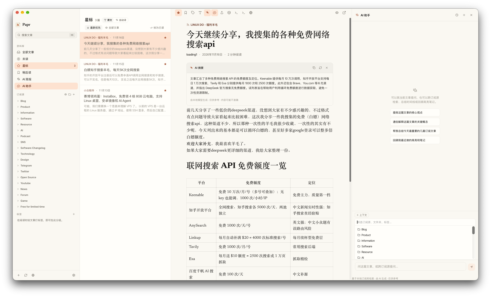
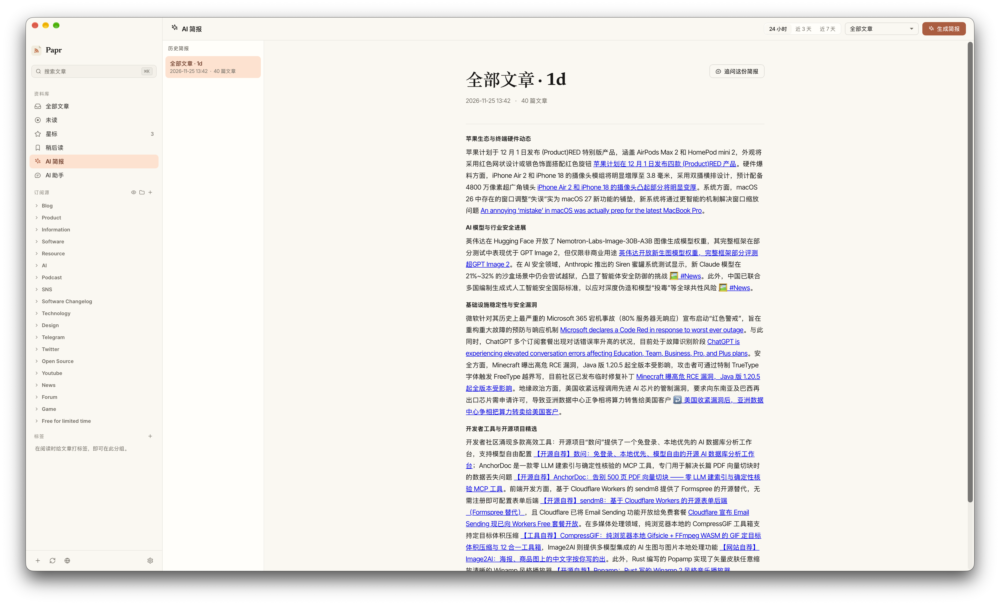
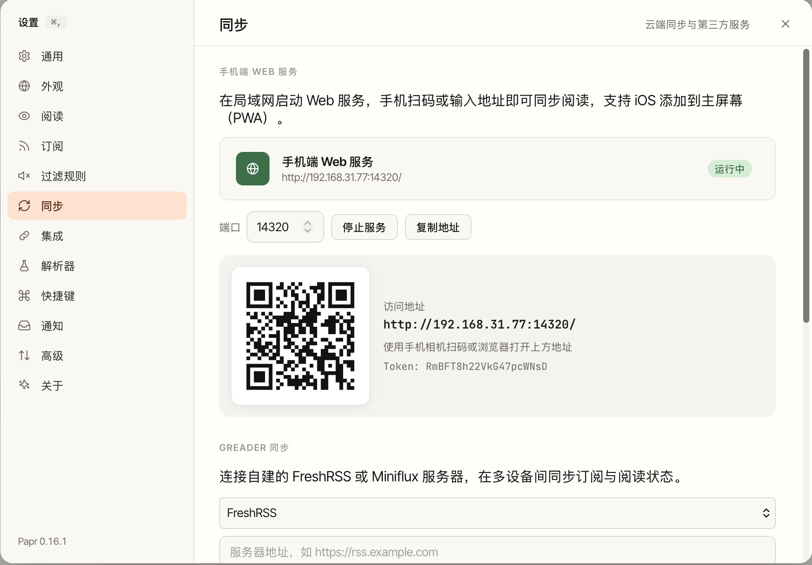
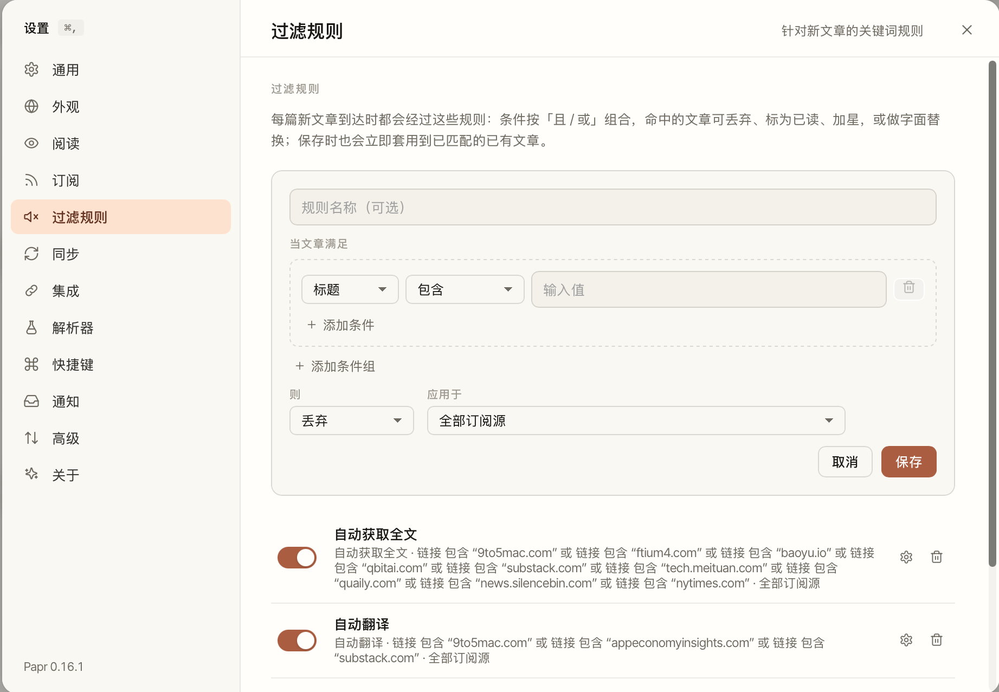
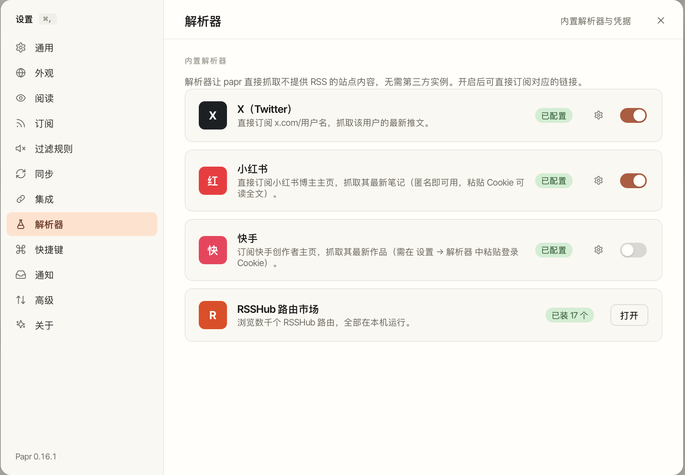
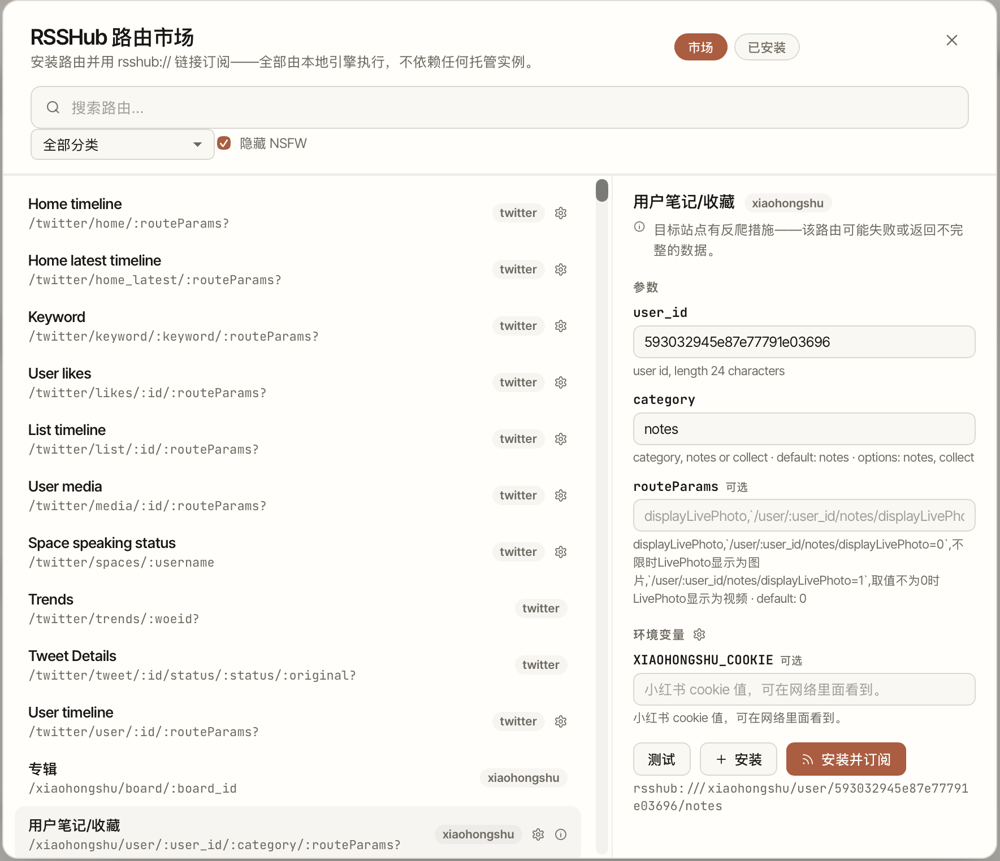
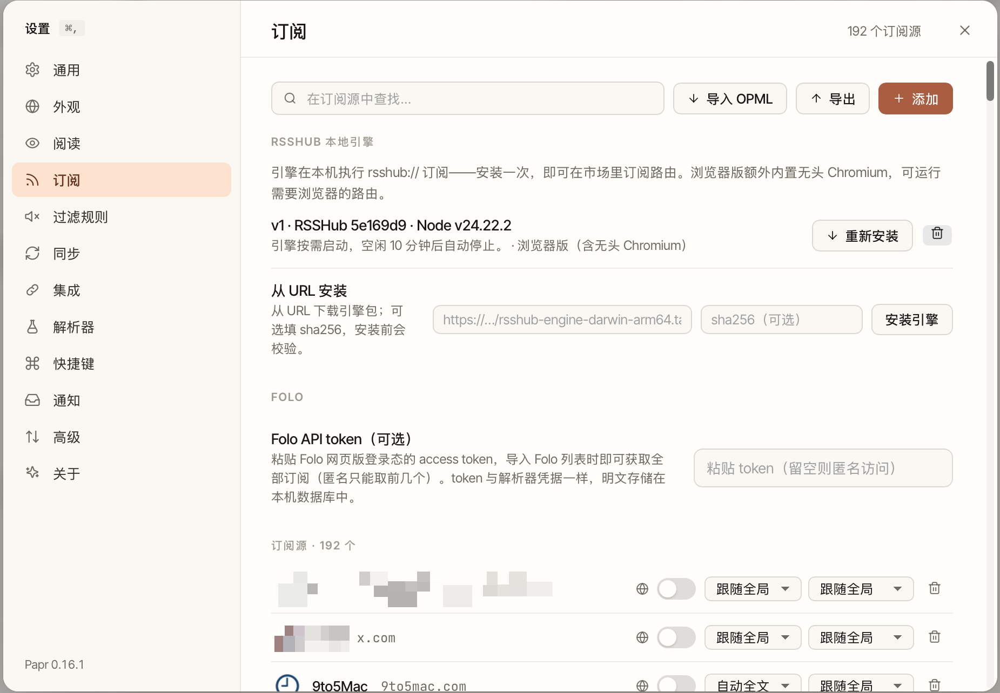
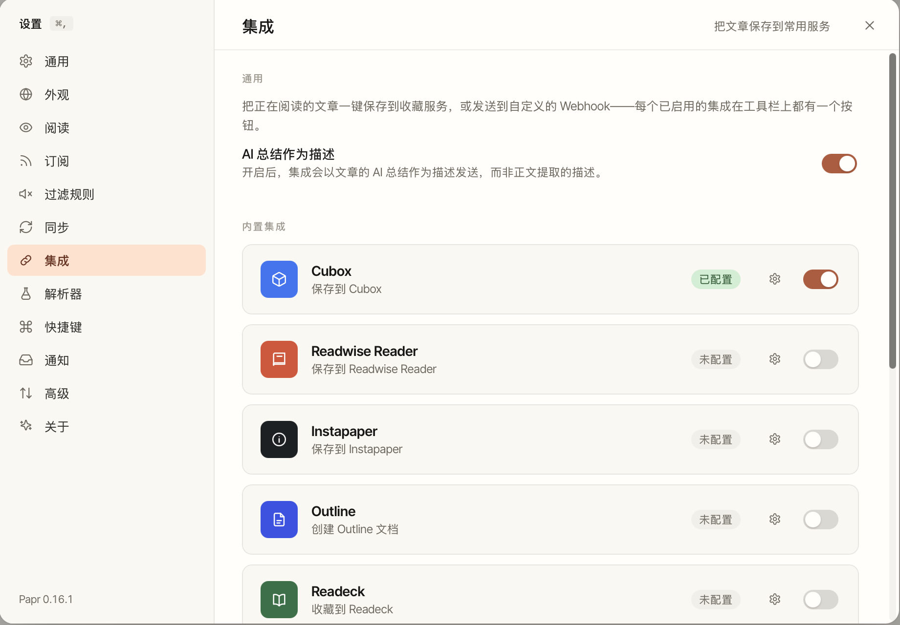
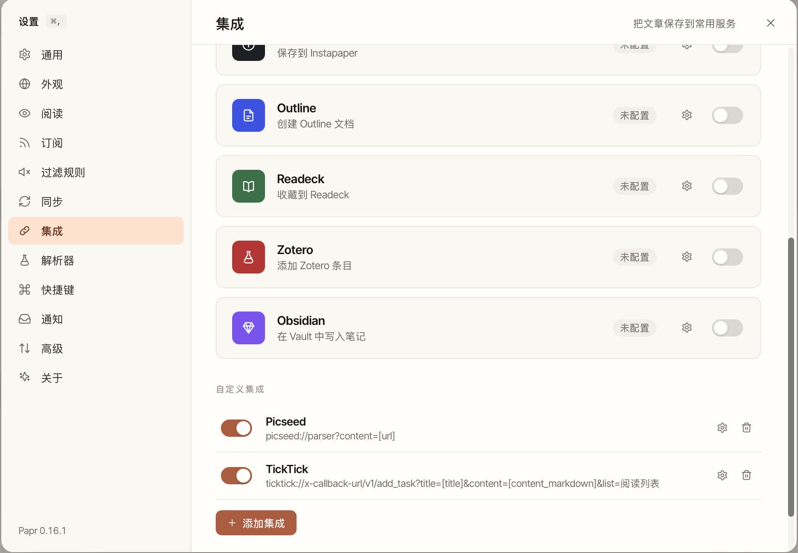

<div align="center">


# Papr (Aminta Fork)

**A fast, native RSS reader — and a CLI your AI agent can actually drive.**

**English** | [简体中文](README.zh-CN.md)

> [!NOTE]
> **Fork Notice & Maintenance Scope**
> This repository is a personal fork of [Papr](https://github.com/l0ng-ai/papr), created to serve as a self-hosted, independent alternative to proprietary/paid reader features (such as Folo's premium capabilities).
>
> You are very welcome to use, fork, or adapt this project for your own workflow. However, please note that **this fork is maintained strictly for personal use: external issues and pull requests will not be accepted**. If you encounter bugs or wish to propose general features or improvements, please submit them directly to the upstream project at [l0ng-ai/papr](https://github.com/l0ng-ai/papr).



</div>

## Fork Highlights & Enhancements

This fork builds on Papr with a global AI reading workspace, LAN mobile PWA access, a programmable rule engine, native social media parsers, an embedded local RSSHub engine, rich export workflows, and hardened feed ingestion & translation:

### 1. Global AI Assistant, AI Briefing & Inline AI Reading ([#3](https://github.com/AmintaCCCP/papr/pull/3), [#15](https://github.com/AmintaCCCP/papr/pull/15), [#17](https://github.com/AmintaCCCP/papr/pull/17))
- **Global Docked AI Assistant**: A persistent right-hand AI sidebar that works both on the currently opened article and across your entire local library. Backed by read-only retrieval tools, it can search subscriptions, folders, tags, highlights, and notes, supports explicit context picking (`+ Context` by feed/folder/tag), streaming replies, conversation history, and quick-start prompts.
- **AI Briefing**: A dedicated briefing workspace that synthesizes articles from the last 24 hours, 3 days, or 7 days (globally or scoped to specific feeds/folders) into structured, topic-grouped digests with clickable article citations, saved briefing history, and one-click **Follow up on this briefing** handoff into the AI Assistant.
- **Folo-Style Inline AI Summary & Prompt Editor**: Renders an inline summary card naturally between the article header and body (with copy, regenerate, dismiss, and optional auto-summarize on open), plus an in-app customizable prompt editor shared across summaries and export integrations.
- **Reader Interaction Enhancements**: Highlight any passage in the reader to trigger **Ask AI** directly in context, alongside a dedicated link context menu.

<p align="center">
  
</p>

### 2. LAN Mobile Web Reader & iOS PWA Support ([#18](https://github.com/AmintaCCCP/papr/pull/18))
- **Built-in Local Web Server**: Start a lightweight HTTP server right from **Settings → Sync → Mobile Web Server** on a configurable port to read and sync directly against your desktop Papr database over LAN — no cloud account or third-party sync server required.
- **Instant QR Pairing & Token Auth**: Scan the generated QR code or open the LAN URL with token authentication from your phone browser.
- **iOS Add to Home Screen (PWA)**: Ships with a web app manifest and service worker for a native-feeling mobile reading experience on iOS and Android.

<p align="center">
  
</p>

### 3. Advanced Filter Rules & Open-Time Automation ([#12](https://github.com/AmintaCCCP/papr/pull/12), [#13](https://github.com/AmintaCCCP/papr/pull/13))
- **When / Then Condition Groups**: Build multi-condition rules using `AND` / `OR` groups across `title`, `author`, `content`, `url`, or `any`, with full `regex` operator support (`regexp()` parity between live Rust ingestion and SQLite preview/backfill).
- **Text Rewrite Action**: Apply literal `from → to` replacements to matched article titles, summaries, and bodies both at ingestion time and via save-time backfill (automatically rebuilding affected FTS entries and invalidating stale derivative caches).
- **Open-Time Actions**: Automatically trigger **Auto Full-Text**, **Auto Translate**, **Auto Summarize**, or **Open Original** whenever you open an article matching your rules (e.g., auto-extract full text and auto-translate specific domains).

<p align="center">
  
</p>

### 4. Native Social Media Parsers & Local RSSHub Engine ([#5](https://github.com/AmintaCCCP/papr/pull/5), [#6](https://github.com/AmintaCCCP/papr/pull/6), [#7](https://github.com/AmintaCCCP/papr/pull/7), [#8](https://github.com/AmintaCCCP/papr/pull/8), [#10](https://github.com/AmintaCCCP/papr/pull/10), [#14](https://github.com/AmintaCCCP/papr/pull/14), [#15](https://github.com/AmintaCCCP/papr/pull/15))
- **Native X (Twitter) Parser**: Subscribes directly to `x.com/<handle>` via official GraphQL endpoints with resilient query ID rotation. Renders attributed tweet cards, highest-bitrate MP4 videos and images, retweets, result-level quote tweets, pinned tweets, and **full-text X long-form Articles** (DraftJS rich content state with downgrade protection).
- **Native Xiaohongshu (RED) & Kuaishou Parsers**:
  - **Xiaohongshu**: Cookie-optional anonymous mode reads server-rendered profile notes out of the box; adding an optional login cookie unlocks per-note full text, image sets, and MP4 videos with throttled fetching.
  - **Kuaishou**: Migrated to the live GraphQL endpoint (`kuaishou.com/profile/<id>`, `live`, and `v.kuaishou.com` share links) with cookie support and clear captcha/risk-control diagnostics.
  - **Shared Anti-Ban Posture**: Strictly serial per-site fetches, jittered pacing, host allow-lists for credentials, and localized per-feed error states.
- **Embedded Local RSSHub Engine & Route Marketplace**:
  - Bundles a local Node 24 + RSSHub runtime on `127.0.0.1` that spawns on demand and idles out after 10 minutes.
  - Supports both `standard` and `browser` engine flavors (bundling `patchright` + headless Chromium for anti-bot routes with no system Chrome required).
  - Offline **Route Marketplace** covering 4,000+ routes across 2,000+ namespaces with search, category filtering, NSFW toggle, pre-filled parameter forms, environment variable configuration, catch-all route params (`{:path*}`), and one-click test/install/subscribe.

<table>
  <tr>
    <td width="50%"></td>
    <td width="50%"></td>
  </tr>
</table>

### 5. Subscriptions, Folo Shared-List Import & Feed Fetch Hardening ([#9](https://github.com/AmintaCCCP/papr/pull/9), [#11](https://github.com/AmintaCCCP/papr/pull/11), [#16](https://github.com/AmintaCCCP/papr/pull/16))
- **One-Click Folo Shared-List Import**: Paste any `app.folo.is/share/lists/…` link into the Add Feed dialog (or run `papr folo import <share-link-or-id>`) to preview and batch-import into a folder. Automatically rewrites `rsshub://twitter/user/*` routes to the native X parser, and accepts an optional **Folo API token** to lift the anonymous list cap.
- **Per-Feed Controls & Edit Dialog**: Configure per-feed full-text and translation overrides directly in Subscriptions or via the per-feed edit dialog.
- **Feed Fetch & Anti-Bot Compatibility**:
  - Switched the HTTP client to `rustls` + native OS roots (fixing TLS handshake drops on hosts like Vercel while still trusting keychain/MITM proxy CAs).
  - Plain browser User-Agent to bypass Tengine/Cloudflare UA blacklists, plus a constrained JS evaluator for cookie-reload WAF challenges.
  - Local RSSHub engine honors system CAs (`NODE_USE_SYSTEM_CA=1` / `NODE_EXTRA_CA_CERTS`) and auto-configures `ALLOW_USER_SUPPLY_UNSAFE_DOMAIN` for `/rsshub/transform/*` routes.

<p align="center">
  
</p>

### 6. Rich Export Integrations & Custom Webhooks ([#1](https://github.com/AmintaCCCP/papr/pull/1))
- **7 Built-in Services**: One-click toolbar dispatch to **Cubox**, **Readwise Reader**, **Instapaper**, **Outline**, **Readeck**, **Zotero**, and **Obsidian** (writes Markdown notes with YAML frontmatter directly into your vault).
- **Custom Webhooks & URL Schemes**: Full HTTP method support (`GET`, `POST`, `PUT`, `PATCH`, `DELETE`) with custom headers/payloads and native URI schemes (e.g., `picseed://`, `ticktick://`, `obsidian://`), powered by 8 dynamic template variables (`[title]`, `[url]`, `[content_html]`, `[content_markdown]`, `[summary]`, `[description]`, `[author]`, `[published_at]`).
- **On-Demand AI Summary Handoff & Native Rust Dispatch**: Optionally send the AI summary as the exported description (generating it on the fly if missing); all requests execute natively in Rust, bypassing webview CORS limits.

<table>
  <tr>
    <td width="50%"></td>
    <td width="50%"></td>
  </tr>
</table>

### 7. Hardened Keyless Translation & UI Polish ([#2](https://github.com/AmintaCCCP/papr/pull/2), [#4](https://github.com/AmintaCCCP/papr/pull/4), [#9](https://github.com/AmintaCCCP/papr/pull/9), [#14](https://github.com/AmintaCCCP/papr/pull/14))
- **Reliable Keyless Engines**: Migrated Bing to Edge's keyless `translatetext` API and Google to Chromium's batch endpoint (`clients5.google.com`), supporting both article body and title translation.
- **Scoped Viewport Translation**: Translates only the currently opened article instead of queuing every visible list item, avoiding 429 rate-limiting, alongside a settings engine race-condition fix.
- **Dialog & IME Robustness**: IME-safe `Escape` handling (`isComposing` guard), nested-modal Escape scoping, and click-drag text selection inside dialogs no longer accidentally closes modals.

---

Papr is two front-ends over **one local database**:

- **A desktop reader** — fast, native, offline-first. No account, no cloud.
- **`papr`, an agent-facing CLI** — so an autonomous agent (Claude Code, Codex,
  OpenCode…) can read, search and triage your feeds straight from the shell.
  [Jump to it ↓](#papr--your-feeds-handed-to-your-agent)

Both read the same database through the shared `papr-core` crate, so the app and
the CLI can never drift apart.

---

## The desktop app

- **Feeds & folders** — subscribe, organize, and import/export OPML.
- **Smart views** — All, Unread, Starred, Read Later, AI Briefing, and AI Assistant, with live counts.
- **Tags & rules** — color-coded tags and programmable When/Then rules with open-time actions.
- **Full-text** — fetch and clean the complete article when a feed ships only a summary.
- **AI** — inline summaries, global & per-article AI assistant, and scheduled/on-demand briefings. Bring your own API key.
- **Audio** — a built-in player that follows you from article to article.
- **Sync & Mobile** — FreshRSS / Miniflux sync plus a built-in LAN Mobile Web Reader (PWA).
- **Local-first** — everything stays on your machine. No account, no cloud.
- **Localized** — English, Japanese, and Simplified Chinese.

### Install (Upstream Releases)

| Platform | How |
| --- | --- |
| **macOS** | `brew install --cask l0ng-ai/papr/papr` — or grab the `.dmg` |
| **Windows** | Download the `.msi` installer |
| **Linux** | Download the `.AppImage` or `.deb` |

Upstream packages live on **[l0ng-ai/papr releases](https://github.com/l0ng-ai/papr/releases/latest)**. To use the enhancements in this fork, build from source or grab builds from this repository's releases.

---

## `papr` — your feeds, handed to your agent

This is what makes Papr different. `papr` is a command-line companion built **for
autonomous agents** to drive over the shell. Point your agent at it and it can
work your feeds with no GUI:

- **Read** — `feeds`, `list`, `read`, full-text `search`
- **Triage** — `mark` read/star/later, `extract` full text, `refresh`
- **Manage** — subscriptions, folders, tags, rules, highlights, OPML, `folo import`
- **Sync** — FreshRSS / Miniflux

Run bare `papr` and it prints your unread dashboard *plus the next useful
commands*, so the agent orients with zero manual. Output is
[TOON](https://toonformat.dev) — ~40% fewer tokens than JSON — with definitive
counts and structured exit codes.

```console
$ papr
unread: 206   starred: 17   later: 0   feeds: 15
articles[10]{id,feed,title,flags,date}:
  3664,V2EX,[Java] 使用 kkRepo 搭建 Maven 私服,unread.star,"2026-06-25"
  ...
help[4]: Run `papr read <id>` to read an article's full text, ...
```

### Hand it to your agent — one line

The bundled **[`papr-rss` skill](skills/papr-rss/SKILL.md)** loads *on demand*
when an agent recognizes a feed-related task, so it costs nothing until you use
it. Install it with [`skills`](https://github.com/vercel-labs/skills):

```sh
npx skills add https://github.com/l0ng-ai/papr/tree/main/skills/papr-rss
```

Want the agent *proactively* aware of your feeds every conversation? `papr setup`
wires up an ambient SessionStart hook (Claude Code, Codex, OpenCode).

### Install the CLI

| Platform | How |
| --- | --- |
| **macOS / Linux** | `brew install l0ng-ai/papr/papr-cli` |
| **Windows** | Download `papr-x86_64-pc-windows-msvc.zip`, unzip, drop `papr.exe` on your `PATH` |
| **Any** | Prebuilt `papr-<target>.tar.gz` from the [latest release](https://github.com/l0ng-ai/papr/releases/latest), or `cargo build --release -p papr-cli` |

> **Full command reference, agent setup, and install options → [docs/cli.md](docs/cli.md)**
