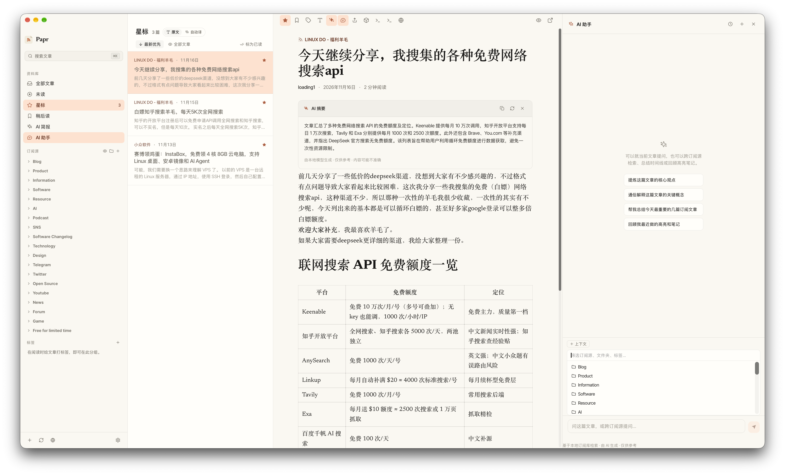
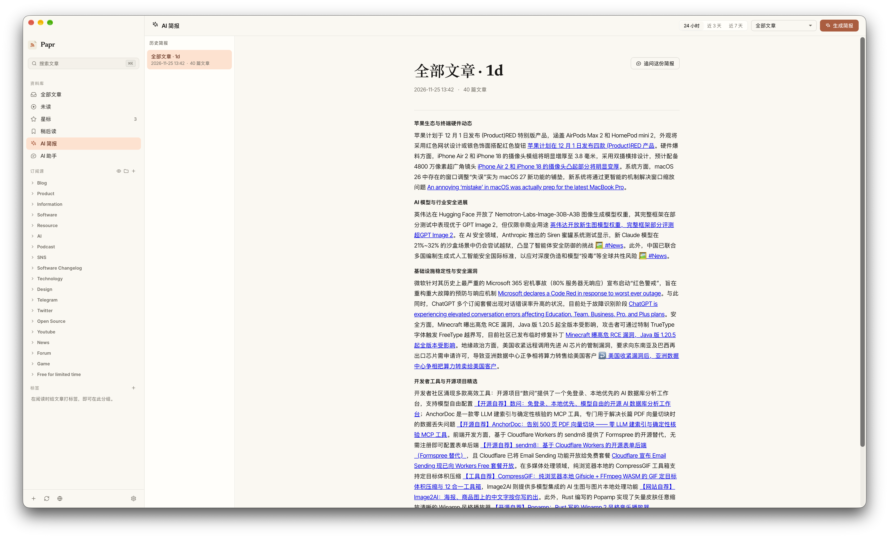
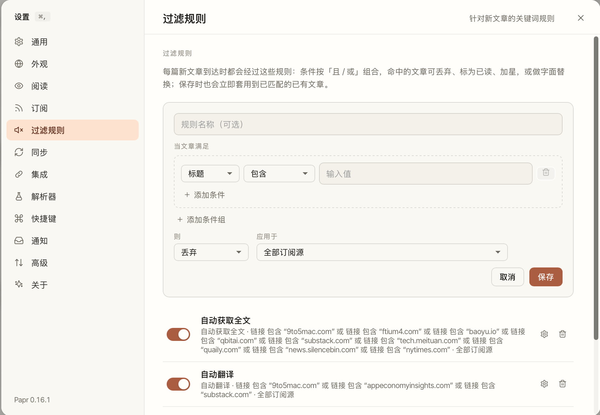
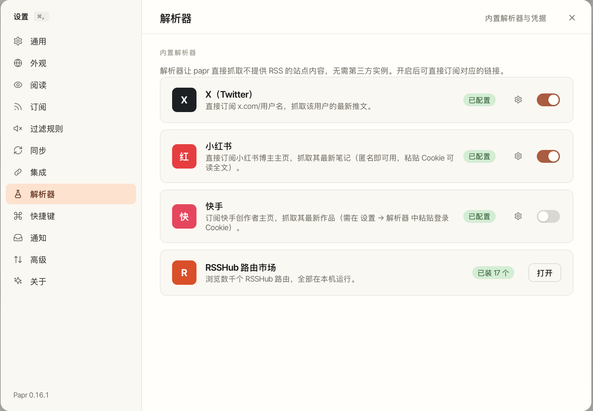
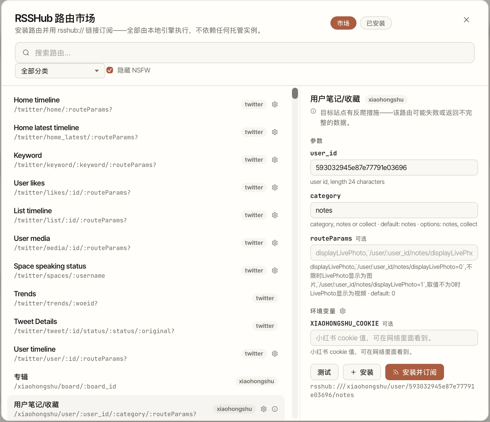
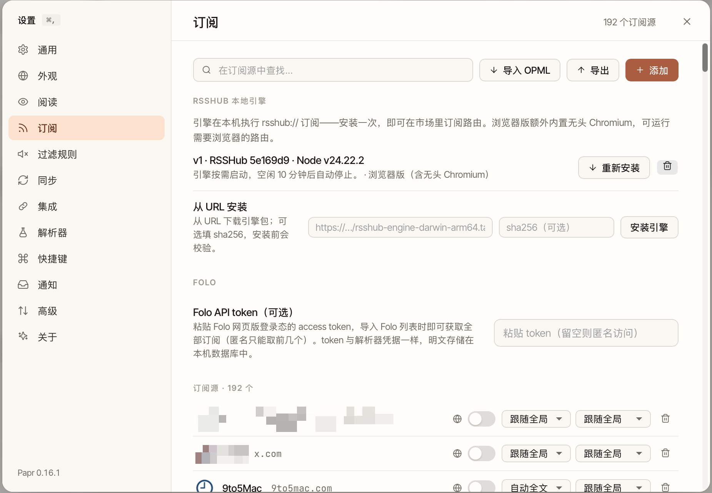
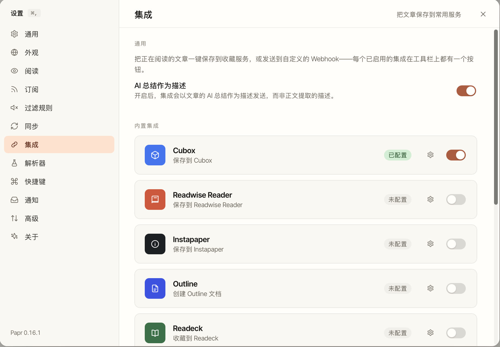
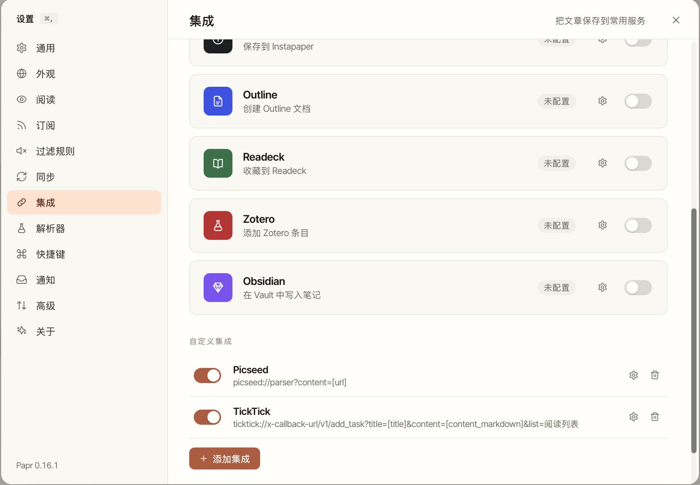

<div align="center">


# Papr (Aminta Fork)

**一款极速、原生的本地 RSS 阅读器——同时配备你的 AI Agent 可直接驱动的命令行工具。**

[English](README.md) | **简体中文**

> [!NOTE]
> **Fork 说明与维护范围**
> 本仓库是 [Papr](https://github.com/l0ng-ai/papr) 的个人定制分支，旨在作为商业/付费阅读器高级功能（例如 Folo 的订阅增值能力）的自托管独立替代方案。
>
> 欢迎自由使用、Fork 或按自己的工作流二次修改。但请注意：**本分支仅面向个人自用维护，不接受外部 Issue 与 Pull Request**。如果你遇到通用 Bug 或希望提出面向原项目的功能建议，请直接前往上游仓库 [l0ng-ai/papr](https://github.com/l0ng-ai/papr) 提交。



</div>

## 分支亮点与增强特性

本分支在原版 Papr 基础上，重点扩展了全局 AI 阅读工作台、局域网移动端 PWA 阅读、可编程过滤与打开时规则引擎、原生社交媒体解析器、本地内嵌 RSSHub 引擎、丰富的导出集成以及抓取与翻译稳定性加固：

### 1. 全局 AI 助手、AI 简报与内联 AI 阅读体验（[#3](https://github.com/AmintaCCCP/papr/pull/3)、[#15](https://github.com/AmintaCCCP/papr/pull/15)、[#17](https://github.com/AmintaCCCP/papr/pull/17)）
- **全局停靠式 AI 助手**：常驻阅读器右侧的 AI 侧边栏，既可围绕当前文章深度对话，也可通过内置只读检索工具跨全库搜索订阅源、文件夹、标签、高亮与笔记；支持按订阅源/文件夹/标签自由挂载上下文（`+ 上下文`）、流式输出、对话历史以及快捷提问。
- **AI 简报页**：独立的简报视图，支持按 **24 小时 / 近 3 天 / 近 7 天** 与自定义订阅范围一键生成分主题结构化简报，附带可点击直达原文的引用链接、历史简报留存，并支持一键**追问这份简报**无缝衔接至 AI 助手。
- **Folo 风格内联 AI 摘要与提示词编辑器**：以自然融入正文流的内联卡片替代抽屉弹窗，支持一键复制 Markdown、重新生成、关闭以及打开文章时自动摘要；内置自定义提示词编辑器，统一作用于阅读器摘要与外部导出集成。
- **阅读器交互增强**：划词选字即可触发 **问 AI**，并新增文章内链接右键菜单。

<p align="center">
  
</p>

### 2. 局域网手机端 Web 阅读器与 iOS PWA 支持（[#18](https://github.com/AmintaCCCP/papr/pull/18)）
- **内置局域网 Web 服务**：在 **设置 → 同步 → 手机端 Web 服务** 中一键启停本地 HTTP 服务（支持自定义端口），手机直接读写桌面端同一份本地数据库，无需任何云账号或第三方同步服务。
- **扫码即连与 Token 鉴权**：自动生成访问二维码与随机 Token，手机相机扫码或浏览器输入局域网地址即可同步阅读。
- **iOS 添加到主屏幕（PWA）**：内置 Web App Manifest 与 Service Worker，在 iOS / Android 上可添加到主屏幕获得接近原生 App 的移动阅读体验。

<p align="center">
  
</p>

### 3. 高级过滤规则与打开时自动化动作（[#12](https://github.com/AmintaCCCP/papr/pull/12)、[#13](https://github.com/AmintaCCCP/papr/pull/13)）
- **When / Then 条件组与正则匹配**：支持按「且 / 或」自由组合多个条件组，覆盖标题、作者、正文、链接、任意字段，支持完整正则表达式（Rust 实时抓取与 SQLite 预览/回溯共用同一正则语义）。
- **字面替换（Text Rewrite）**：对命中文章的标题、摘要与正文执行精确替换，保存时支持对已有历史文章回溯生效，并自动重建受影响的 FTS 全文索引与清理失效缓存。
- **打开时动作（Open-Time Actions）**：支持为命中的规则配置 **自动获取全文**、**自动翻译**、**自动摘要** 或 **打开原文**，例如针对特定英文站点或摘要源在打开文章时自动抓取全文并翻译。

<p align="center">
  
</p>

### 4. 原生社交媒体解析器与本地 RSSHub 引擎（[#5](https://github.com/AmintaCCCP/papr/pull/5)、[#6](https://github.com/AmintaCCCP/papr/pull/6)、[#7](https://github.com/AmintaCCCP/papr/pull/7)、[#8](https://github.com/AmintaCCCP/papr/pull/8)、[#10](https://github.com/AmintaCCCP/papr/pull/10)、[#14](https://github.com/AmintaCCCP/papr/pull/14)、[#15](https://github.com/AmintaCCCP/papr/pull/15)）
- **原生 X（Twitter）解析器**：直连 X 官方 GraphQL 接口，无需第三方中转实例；支持 Query ID 自动提取与失效轮换、原汁原味的推文卡片排版、最高码率 MP4 视频与图片、转推/引用归属、置顶推文，以及 **X 长文（Article）完整富文本正文抓取**（DraftJS 渲染与防降级保护）。
- **原生小红书与快手解析器**：
  - **小红书**：匿名模式免 Cookie 即可抓取博主主页最新笔记卡片；粘贴登录 Cookie（可选）可进一步按需抓取新笔记的完整正文、图集与 MP4 视频，并内置抖动限流与失败重试队列。
  - **快手**：已迁移至 live GraphQL 接口（兼容 `www`、`live` 与 `v.kuaishou.com` 分享链接），支持 Cookie 凭据与清晰的风控/验证码本地化提示。
  - **统一防风控策略**：单站点严格串行、随机抖动间隔、仅抓首页只读请求、凭据严格绑定宿主白名单。
- **本地内嵌 RSSHub 引擎与路由市场**：
  - 内置轻量级 Node 24 + RSSHub 本地运行时，监听 `127.0.0.1`，按需拉起并在空闲 10 分钟后自动退出，彻底摆脱公共实例限流或不可用问题。
  - 提供 **标准版** 与 **浏览器版** 两种引擎包（浏览器版额外内置 `patchright` 与无头 Chromium，无需本机安装 Chrome 即可运行反爬路由）。
  - 离线 **RSSHub 路由市场** 收录 2,000+ 命名空间、4,000+ 路由，支持搜索、分类筛选、隐藏 NSFW、参数表单与示例预填、环境变量配置、通配路由参数（`{:path*}`）以及一键测试/安装/订阅。

<table>
  <tr>
    <td width="50%"></td>
    <td width="50%"></td>
  </tr>
</table>

### 5. 订阅管理、Folo 分享列表导入与抓取兼容性加固（[#9](https://github.com/AmintaCCCP/papr/pull/9)、[#11](https://github.com/AmintaCCCP/papr/pull/11)、[#16](https://github.com/AmintaCCCP/papr/pull/16)）
- **Folo 分享列表一键迁移**：在「添加订阅」中粘贴 Folo 分享链接（`app.folo.is/share/lists/…`）或通过 CLI 运行 `papr folo import <链接或ID>`，即可预览并批量去重导入至指定文件夹；自动将 `rsshub://twitter/user/*` 路由重写为内置 X 解析器，并支持配置可选的 **Folo API token** 以解除匿名导入数量限制。
- **单源独立配置与编辑弹窗**：支持按订阅源单独设置自动全文与自动翻译策略，并提供完善的订阅源编辑弹窗。
- **抓取链路与反爬兼容性加固**：
  - HTTP 客户端切换为 `rustls` + 系统根证书，解决部分站点（如 Vercel 等）在原生 TLS 下的握手失败，同时完整兼容系统钥匙串中的代理/MITM 根证书。
  - 统一使用标准浏览器 User-Agent 绕过 Tengine / Cloudflare 的 UA 黑名单，并内置受限 JS 求值器自动处理基于 Cookie 重载的 WAF 质询。
  - 本地 RSSHub 引擎自动信任系统 CA（`NODE_USE_SYSTEM_CA=1` / `NODE_EXTRA_CA_CERTS`），并为 `/rsshub/transform/*` 路由自动补齐所需环境变量。

<p align="center">
  
</p>

### 6. 丰富的导出集成与自定义 Webhook / URL Scheme（[#1](https://github.com/AmintaCCCP/papr/pull/1)）
- **7 款内置收藏与笔记服务**：阅读器工具栏一键发送至 **Cubox**、**Readwise Reader**、**Instapaper**、**Outline**、**Readeck**、**Zotero** 与 **Obsidian**（直接写入带 YAML Frontmatter 的 Markdown 笔记到本地 Vault）。
- **自定义 Webhook 与原生 URL Scheme**：支持完整 HTTP 方法（`GET` / `POST` / `PUT` / `PATCH` / `DELETE`）、自定义请求头与模板，以及原生协议调用（如 `picseed://`、`ticktick://`、`obsidian://`）；内置 8 个动态模板变量（`[title]`、`[url]`、`[content_html]`、`[content_markdown]`、`[summary]`、`[description]`、`[author]`、`[published_at]`）。
- **AI 摘要透传与 Rust 原生发送**：可选开启「AI 总结作为描述」（未生成时按需即时生成并持久化）；所有请求均由后端 Rust 原生发出，不受 Webview CORS 限制。

<table>
  <tr>
    <td width="50%"></td>
    <td width="50%"></td>
  </tr>
</table>

### 7. 免 Key 翻译引擎加固与交互细节打磨（[#2](https://github.com/AmintaCCCP/papr/pull/2)、[#4](https://github.com/AmintaCCCP/papr/pull/4)、[#9](https://github.com/AmintaCCCP/papr/pull/9)、[#14](https://github.com/AmintaCCCP/papr/pull/14)）
- **修复并增强免费翻译通道**：Bing 迁移至 Edge 免 Key `translatetext` 接口，Google 切换至 Chromium 批量接口（`clients5.google.com`），同时支持文章正文与标题翻译。
- **精准视口翻译与竞态修复**：自动翻译严格限定在当前打开的文章，避免批量队列触发 Google 429 限流，并修复切换翻译引擎时的状态竞态问题。
- **弹窗与输入法体验优化**：所有弹窗与命令面板支持 IME 安全的 `Escape` 防误关（`isComposing` 守卫）、嵌套弹窗逐层关闭，以及弹窗内拖拽选字不再误关弹窗。

---

Papr 是共享**同一份本地数据库**的双前端架构：

- **桌面端阅读器** — 极速、原生、本地优先，无账号、无云端依赖。
- **`papr` 命令行工具** — 专为 AI Agent（Claude Code、Codex、OpenCode 等）打造，让 Agent 直接在终端里阅读、检索与整理你的订阅源。[跳转查看 ↓](#papr--把你的订阅源交给-ai-agent)

两者通过共享的 `papr-core` crate 访问同一个 SQLite 数据库，桌面端与 CLI 数据永远保持一致。

---

## 桌面端核心能力

- **订阅源与文件夹** — 订阅管理、文件夹分类、OPML 导入导出。
- **智能视图** — 全部文章、未读、星标、稍后读、AI 简报、AI 助手，实时计数。
- **标签与规则** — 彩色标签与支持自动化动作的过滤规则。
- **全文提取** — 针对仅输出摘要的 RSS 源一键抓取并净化正文。
- **AI 能力** — 内联摘要、单篇与跨库全局 AI 助手、周期简报（BYOK 自带 API Key）。
- **音频播放** — 内置播放器，跨文章连续播放不中断。
- **同步与移动端** — 支持 FreshRSS / Miniflux 同步，内置局域网手机端 Web 阅读器（PWA）。
- **本地优先** — 所有数据均保存在本机，无需账号与云服务。
- **多语言界面** — 支持简体中文、英文与日文。

### 安装（上游原版发布）

| 平台 | 安装方式 |
| --- | --- |
| **macOS** | `brew install --cask l0ng-ai/papr/papr` 或下载 `.dmg` |
| **Windows** | 下载 `.msi` 安装包 |
| **Linux** | 下载 `.AppImage` 或 `.deb` |

原版安装包位于 **[l0ng-ai/papr Releases](https://github.com/l0ng-ai/papr/releases/latest)**；如需体验本分支的全部增强功能，请从源码构建或在本仓库 Releases 中获取构建产物。

---

## `papr` — 把你的订阅源交给 AI Agent

这是 Papr 最与众不同的地方：`papr` 是专为 **自主 AI Agent** 设计的命令行伴侣。无需打开 GUI，Agent 即可通过 Shell 完成订阅工作流：

- **阅读** — `feeds`、`list`、`read`、全文检索 `search`
- **整理** — `mark` 已读/星标/稍后读、`extract` 提取全文、`refresh` 刷新
- **管理** — 订阅源、文件夹、标签、规则、高亮、OPML、`folo import`
- **同步** — FreshRSS / Miniflux

直接运行 `papr` 即可输出未读仪表盘以及*下一步建议命令*，Agent 零学习成本即可上手。默认输出采用 [TOON](https://toonformat.dev) 格式——比 JSON 节省约 40% Token，并附带明确计数与结构化退出码。

```console
$ papr
unread: 206   starred: 17   later: 0   feeds: 15
articles[10]{id,feed,title,flags,date}:
  3664,V2EX,[Java] 使用 kkRepo 搭建 Maven 私服,unread.star,"2026-06-25"
  ...
help[4]: Run `papr read <id>` to read an article's full text, ...
```

### 一行命令接入你的 Agent

内置的 **[`papr-rss` skill](skills/papr-rss/SKILL.md)** 会在 Agent 识别到订阅相关任务时*按需加载*，平时零上下文开销。使用 [`skills`](https://github.com/vercel-labs/skills) 一键安装：

```sh
npx skills add https://github.com/l0ng-ai/papr/tree/main/skills/papr-rss
```

希望 Agent 在每次对话启动时主动感知你的订阅动态？运行 `papr setup` 即可自动配置 SessionStart Hook（支持 Claude Code、Codex、OpenCode）。

### 安装 CLI

| 平台 | 安装方式 |
| --- | --- |
| **macOS / Linux** | `brew install l0ng-ai/papr/papr-cli` |
| **Windows** | 下载 `papr-x86_64-pc-windows-msvc.zip`，解压后将 `papr.exe` 加入 `PATH` |
| **全平台** | 从 [最新 Release](https://github.com/l0ng-ai/papr/releases/latest) 下载预编译 `papr-<target>.tar.gz`，或执行 `cargo build --release -p papr-cli` 自行编译 |

> **完整命令参考、Agent 配置与安装选项 → [docs/cli.md](docs/cli.md)**
